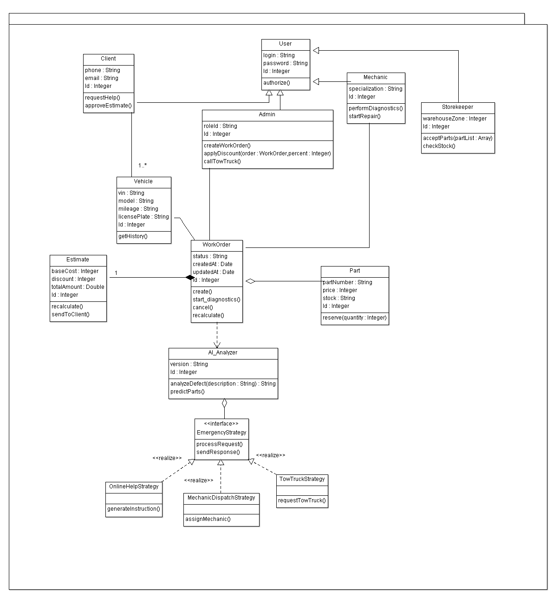

# SmartAutoService — проектирование автосервиса

Учебный проект по проектированию информационных систем. Задача — описать, как автосервис принимает клиента, проводит диагностику, согласует стоимость, заказывает запчасти и доводит ремонт до выдачи автомобиля.

В репозитории собраны UML-модели и пояснения к решениям. Исполняемого приложения здесь нет: результат работы — модель системы.

## Что посмотреть

| Материал | Что показывает |
| :--- | :--- |
| [Классы и стратегия помощи](diagrams/classes-strategy.png) | Клиенты, сотрудники, автомобили, заказ-наряд, смета, запчасти и варианты экстренной помощи. |
| [Состояния заказ-наряда](diagrams/work-order-states.png) | Диагностика, согласование, ожидание запчастей, ремонт, выдача и отмена. |
| [Заказ запчастей](diagrams/parts-order.png) | Передачу работы между участниками процесса снабжения. |
| [Диагностика и согласование](diagrams/diagnostics.png) | Взаимодействие клиента и сервиса до начала ремонта. |
| [Экстренная помощь](diagrams/emergency-help.png) | Выбор подходящего способа помощи при поломке. |

Пояснения к процессам, состояниям и ограничениям модели — в [design.md](docs/design.md). Исходные модели ArgoUML находятся в [models](models): их можно открыть в редакторе, а изображения позволяют посмотреть результат без установки программы.

## Моя часть работы

Проект начинался в группе из трёх человек. Моя часть — дальнейшая проработка процессов, жизненного цикла заказ-наряда, модели классов и выбора стратегии экстренной помощи. Здесь собрана эта часть проектирования; полный исходный отчёт — общая работа группы.

## Зачем здесь несколько видов диаграмм

Деятельности показывают, кто и в каком порядке выполняет работу. Состояния описывают жизнь одного заказ-наряда и условия переходов. Классы связывают эти процессы с сущностями и их обязанностями. Стратегия выделяет разные способы экстренной помощи за общим интерфейсом.

Это учебная модель. Дальше её стоит проверить сквозными сценариями и уточнить контракты методов, права доступа, конкурентное резервирование запчастей и обработку внешних ошибок.
