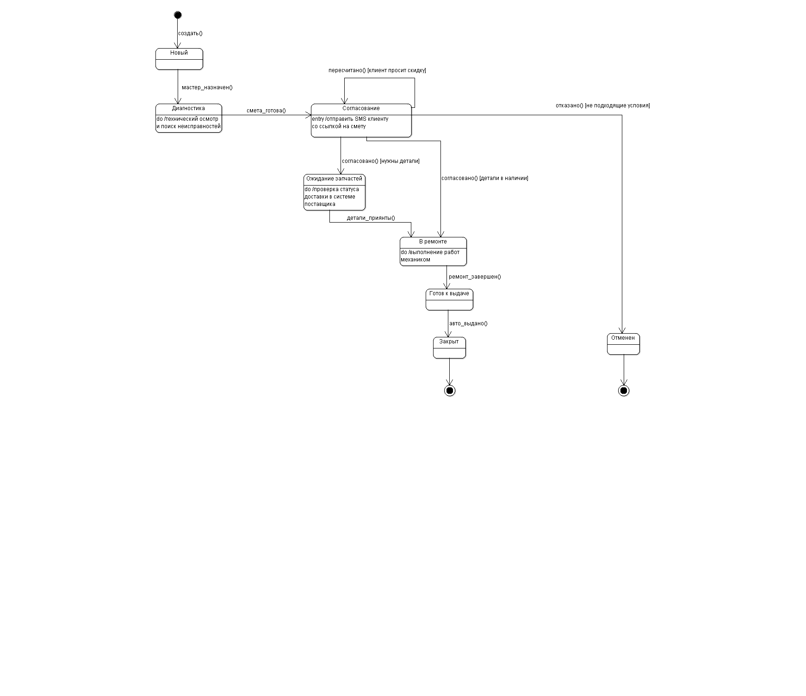

# Как устроена модель

## Участники и сущности

Клиент обращается в сервис, согласует смету и получает автомобиль. Администратор ведёт заказ-наряд и организует работу. Механик диагностирует и ремонтирует автомобиль. Кладовщик проверяет наличие и принимает запчасти.

Центральная сущность — `WorkOrder`. Она связана с автомобилем `Vehicle`, сметой `Estimate` и запчастями `Part`. Общие сведения об учётной записи вынесены в `User`, от которого наследуются роли.

## Согласование ремонта

После создания заказ-наряд попадает на диагностику. Когда смета готова, начинается согласование с клиентом. Согласие ведёт к ремонту или ожиданию запчастей — в зависимости от наличия деталей. Отказ переводит заказ в отменённое состояние. Запрос скидки возвращает процесс к пересчёту сметы.

Такой разбор разделяет три разных события: смета подготовлена, клиент согласился, необходимые детали доступны. Их нельзя заменить одной общей отметкой «заказ в работе».

## Жизненный цикл заказ-наряда

Исходная диаграмма содержит восемь состояний: новый, диагностика, согласование, ожидание запчастей, в ремонте, готов к выдаче, закрыт и отменён. Заказ закрывается после выдачи автомобиля; окончание ремонта само по себе ещё не означает закрытие.

## Экстренная помощь и Strategy

Для обращения при поломке предусмотрены разные способы реакции: дистанционная инструкция, выезд механика или эвакуатор. В модели они вынесены в `OnlineHelpStrategy`, `MechanicDispatchStrategy` и `TowTruckStrategy` за интерфейсом `EmergencyStrategy`.

Смысл решения — отделить выбор способа помощи от конкретного исполнения. Добавление нового варианта не должно требовать расширения одного большого условного блока во всех вызывающих классах.

`AI_Analyzer` присутствует в учебной модели как предполагаемый участник анализа неисправности. Реального AI-сервиса и проверенной логики его решений в этом проекте нет.

## Что требует дальнейшей проработки

- Уточнить одинаковые контракты операций стратегий и отделить хранение данных от бизнес-операций.
- Описать ошибки и повторные запросы: поставщик недоступен, детали не пришли, клиент не ответил.
- Определить правила изменения уже согласованной сметы и историю действий сотрудников.
- Проверить параллельное резервирование одной запчасти для нескольких заказов.
- Детализировать авторизацию и права ролей. Учебный атрибут `password` не задаёт безопасный способ хранения паролей.
- Сверить все переходы состояний со сценариями деятельности: успешный ремонт, отказ от сметы, отсутствие деталей и экстренная помощь.

В архивных исходниках также встречаются автоматически сгенерированные Java-каркасы с пустыми методами. Они не включены в репозиторий: здесь представлен результат проектирования, а не реализованная CRM.
